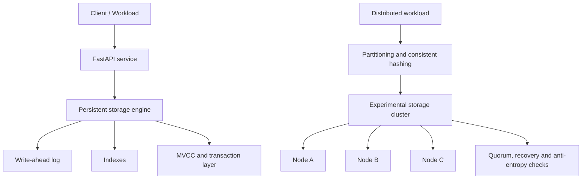
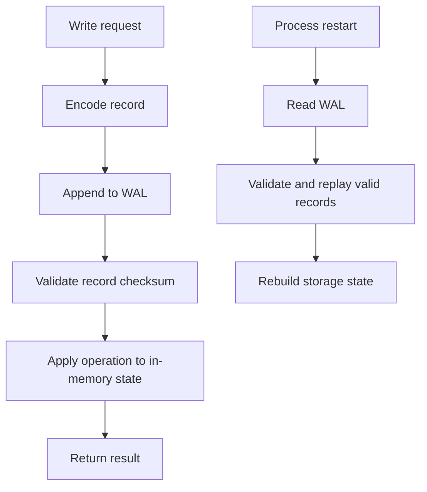
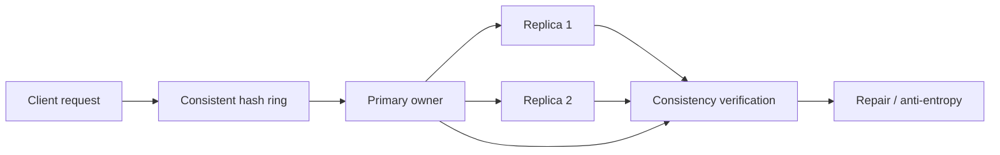

# ATLAS-X
### Storage Engine & Distributed Database Research Platform

<p align="left">
  
  
  
  
  
</p>

**ATLAS-X is an engineering research project for understanding how database systems store, index, recover, transact, replicate, and coordinate data.** It brings together a persistent storage engine, indexing structures, transaction mechanisms, an API layer, and an experimental distributed-storage model.

The project is inspired by the engineering principles behind large-scale infrastructure: explicit failure handling, measurable trade-offs, correctness under concurrency, and clear separation of responsibilities. It is an independent learning and research implementation—not an Amazon product and not production-ready database software.

---

## Engineering scope

| Area | Implemented capabilities |
|---|---|
| Persistent storage | Append-only write-ahead log (WAL), record framing, CRC32 checks, replay and recovery |
| Data operations | PUT, GET, DELETE, SCAN and COUNT |
| Indexing | Hash index, B+ tree operations, Bloom filter |
| LSM concepts | SSTables, flush, compaction, tombstones and batch operations |
| Transactions | MVCC snapshots, read-your-own-writes and write-write conflict detection |
| API | FastAPI endpoints over the persistent storage layer |
| Distributed systems lab | Consistent hashing, replica placement, node registration, heartbeats, failure detection, recovery, quorum operations and anti-entropy experiments |
| Verification | Automated tests for storage, recovery, transactions, API behaviour and distributed failure scenarios |

## System architecture

The repository contains two deliberately separate execution paths:

1. **Persistent API storage** — the local storage engine used by the FastAPI application. Its WAL supports recovery by replaying valid records.
2. **Experimental distributed storage** — a separate in-memory cluster model used to explore partitioning, replication, quorum behaviour, node failures and repair.

They are not presented as one unified durable distributed database. In particular, the distributed replication model is experimental and does not provide durable replication across process crashes.



## 1. Persistent storage engine

The storage layer is designed around an append-only write-ahead log.

- Encodes records with explicit framing.
- Uses CRC32 checks to detect corrupted records.
- Replays valid log records during recovery.
- Supports core key-value operations: `PUT`, `GET`, `DELETE`, `SCAN` and `COUNT`.
- Separates storage responsibilities from the HTTP API.

### Write and recovery path



## 2. Indexing and query structures

ATLAS-X explores multiple structures and their operational trade-offs:

- **Hash index** for point lookups.
- **B+ tree** for ordered keys, search, insertion, deletion and range scans.
- **Bloom filter** for probabilistic membership checks and reducing unnecessary lookups.

The goal is not to claim that one structure is universally fastest. The goal is to understand how access patterns, memory use, write amplification and ordered access influence the choice.

## 3. LSM-tree concepts

The LSM-oriented implementation explores the lifecycle of sorted data:

- In-memory writes and flushes to SSTables.
- Tombstones for deleted keys.
- Compaction to merge sorted files and process obsolete values.
- Batch operations and WAL-based recovery.

Crash-safe manifest management and production-grade compaction coordination remain future engineering work.

## 4. Transactions and MVCC

The transaction layer explores:

- Snapshot-based reads.
- Read-your-own-writes behaviour.
- Write-write conflict detection.
- Version-aware data access and recovery tests.

This is an educational transaction model. It should not be interpreted as a complete implementation of serializable isolation or a replacement for a mature transactional database.

## 5. Experimental distributed storage

The distributed-systems lab models a cluster of storage nodes and investigates:

- Consistent hashing and virtual nodes.
- Partition ownership and replica placement.
- Node registration and heartbeat-based failure detection.
- Replica recovery and consistency checks.
- Quorum operations and versioned replication.
- Anti-entropy repair and simulated node failures.
- Concurrent operations under failure scenarios.

### Distributed model



The distributed cluster is currently an in-memory research model. It is intentionally kept distinct from the persistent API storage engine; replication durability across process restarts is not implemented.

## Testing and quality

The project test suite reports **205 passing automated tests**, with **Ruff lint checks clean**.

Coverage areas include:

- WAL record handling, checksum validation and recovery.
- Key-value operations and index behaviour.
- LSM-oriented operations.
- Transaction and MVCC behaviour.
- FastAPI routes and storage integration.
- Node failures, replica recovery and quorum behaviour.
- Concurrent operations and distributed consistency checks.

Run the test suite from the repository root:

```bash
pytest
```

Run lint checks:

```bash
ruff check .
```

> Test counts describe the current project test run and may change as the implementation evolves.

## Benchmarking

Benchmark reports are maintained in [`benchmarks/BENCHMARK_REPORT.md`](benchmarks/BENCHMARK_REPORT.md), where available. The intended measurements include write throughput, point-read latency and scan performance.

Benchmark numbers should always be interpreted alongside the workload, dataset size, hardware, warm-up, repetition count and measurement method. No performance claim is made here without a reproducible report.

## Technology

| Component | Technology |
|---|---|
| Core implementation | Python |
| HTTP API | FastAPI |
| Automated testing | pytest |
| Linting | Ruff |
| Architecture documentation | Mermaid |

## Engineering decisions and trade-offs

| Design choice | Why it matters | Trade-off / limitation |
|---|---|---|
| Append-only WAL | Makes write history replayable | Requires log management and careful recovery |
| CRC32 record checks | Detects accidental record corruption | Not a cryptographic integrity mechanism |
| B+ tree and hash index | Compares ordered and point-lookup access | Different memory and update costs |
| LSM/SSTable model | Explores write-optimized storage | Compaction introduces write amplification |
| MVCC snapshots | Enables version-aware reads | Version cleanup and isolation semantics are complex |
| Consistent hashing | Limits key movement when membership changes | Correct replica coordination is still required |
| Quorum experiments | Explores availability and consistency trade-offs | Not a proof of production-grade consensus |

## Current limitations

ATLAS-X is an evolving engineering research project. The following boundaries are intentional and should be considered before using it for any real workload:

- It is not production-ready database software.
- Persistent API storage and the experimental distributed in-memory cluster are separate subsystems.
- Distributed replication is not durable across process crashes.
- The transaction model does not provide full serializable isolation guarantees.
- Crash-safe LSM manifest management and production-grade compaction recovery remain future work.
- The distributed model is an experimental environment, not a complete consensus-based database cluster.
- Performance characteristics must be established through reproducible benchmarks rather than inferred from implementation choices.

## Roadmap

- [ ] Durable distributed replication and restart recovery.
- [ ] Crash-safe SSTable manifest and compaction coordination.
- [ ] Stronger transaction isolation and concurrency verification.
- [ ] Reproducible benchmark harness with documented workloads.
- [ ] Fault-injection experiments and recovery-time measurements.
- [ ] Query planning and workload-aware index selection.
- [ ] Explainable comparison of B+ tree and LSM-based workloads.

## Why ATLAS-X?

Database engineering sits at the intersection of algorithms, operating systems, storage, concurrency and distributed systems. ATLAS-X is a hands-on effort to study those boundaries by implementing core mechanisms, testing failure paths and documenting the trade-offs instead of treating a database as a black-box dependency.

The long-term direction is to evolve the project toward a workload-aware storage platform that can compare storage strategies, diagnose bottlenecks and explain measured engineering trade-offs.

---

<p align="center">
  <strong>ATLAS-X</strong><br/>
  Storage systems • Database internals • Distributed systems
</p>
